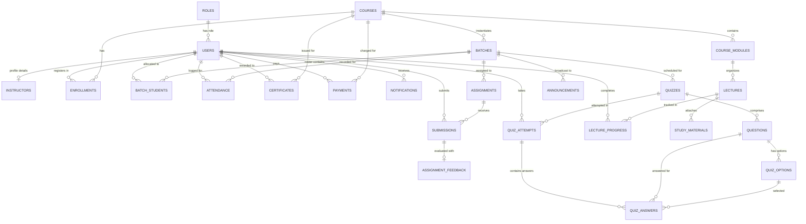

# Entity Relationship Diagram (ERD) & Data Model
**Document Version:** 1.0  
**Date:** November 25, 2026  
**Author:** Senior Full-Stack Engineer  

---

## 1. System Entity Relationship Diagram

---

## 2. Entity Descriptions & Cardinality Summary

| Primary Entity | Child / Related Entities | Cardinality | Deletion Behavior |
| :--- | :--- | :---: | :--- |
| `roles` | `users` | 1 to N | **RESTRICT** (System roles cannot be deleted if users exist) |
| `users` | `instructors`, `enrollments`, `payments` | 1 to N | **RESTRICT / SOFT DELETE** (`is_active = false`) |
| `courses` | `course_modules`, `batches`, `enrollments` | 1 to N | **RESTRICT** if active batches/enrollments exist; **CASCADE** modules on draft |
| `course_modules` | `lectures` | 1 to N | **CASCADE** (Deleting an unpublished module removes lectures) |
| `lectures` | `study_materials`, `lecture_progress` | 1 to N | **CASCADE** (Cascade materials and progress records) |
| `batches` | `batch_students`, `assignments`, `quizzes` | 1 to N | **RESTRICT** if students enrolled |
| `assignments` | `submissions` | 1 to N | **RESTRICT** if evaluated submissions exist |
| `submissions` | `assignment_feedback` | 1 to 1 | **CASCADE** with parent submission |
| `quizzes` | `questions`, `quiz_attempts` | 1 to N | **RESTRICT** if student attempts exist |
| `questions` | `quiz_options`, `quiz_answers` | 1 to N | **CASCADE** options; **RESTRICT** if answered in attempts |
| `quiz_attempts`| `quiz_answers` | 1 to N | **CASCADE** with parent attempt |
| `certificates` | `users`, `courses` | N to 1 | **IMMUTABLE** (Audit trail, cannot be deleted once issued) |
| `payments` | `users`, `courses` | N to 1 | **IMMUTABLE** (Financial ledger, soft status updates only) |
