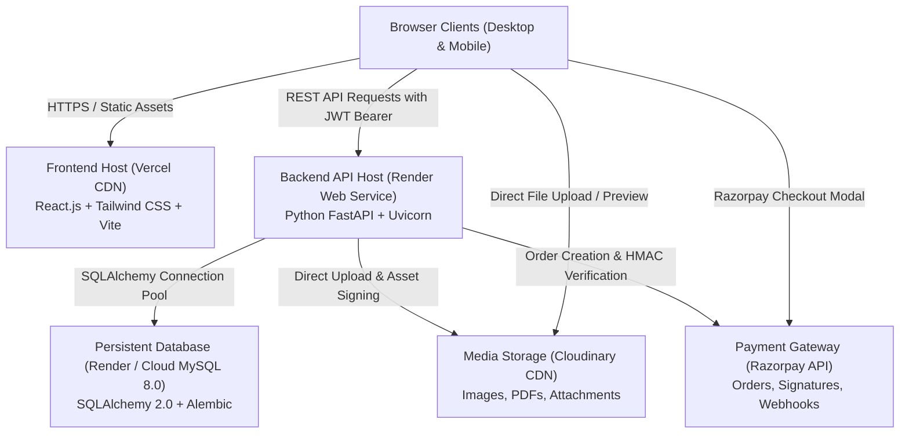
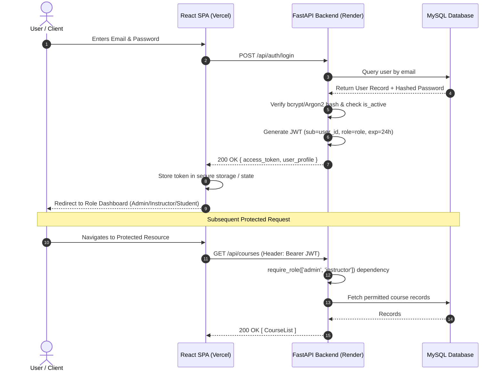

# System Architecture & Technical Design
**Document Version:** 1.0  
**Date:** November 25, 2026  
**Author:** Senior Full-Stack Engineer  

---

## 1. High-Level System Architecture

---

## 2. Layered Component Architecture

### 2.1 Frontend Presentation Layer (React.js + Tailwind CSS)
* **Build Tooling:** Vite for near-instant Hot Module Replacement (HMR) and optimized minified production rollups.
* **Routing:** `react-router-dom` v6 with role-aware `<ProtectedRoute role={["admin"]} />` guards.
* **State Management:**
  - `AuthContext`: Centralized user session, token lifecycle, and role state.
  - `NotificationContext`: Real-time toast alerts and polling for unread messages.
* **API Service Layer:** Axios instance pre-configured with `baseURL`, automatic request interceptor attaching `Authorization: Bearer <token>`, and response interceptor redirecting to login on HTTP 401.
* **Visualizations:** `recharts` for administrative KPI trends, enrollment charts, and revenue comparisons.

### 2.2 Backend Application Layer (Python FastAPI)
* **Framework:** FastAPI utilizing ASGI (`uvicorn`) for asynchronous non-blocking I/O.
* **Validation & Serialization:** Pydantic v2 schemas providing strict type enforcement, input sanitization, and output filtering (excluding sensitive hash columns).
* **Dependency Injection:**
  - `get_db`: Yields transactional SQLAlchemy database sessions per request.
  - `get_current_user`: Decodes and validates JWT bearer tokens.
  - `require_role(["admin", ...])`: Enforces role-based permissions per endpoint.
* **Services Layer:** Decoupled business logic isolated from HTTP routing (e.g. `PaymentService`, `CertificateService`, `MediaService`).

### 2.3 Data & Persistence Layer (MySQL & SQLAlchemy)
* **ORM:** SQLAlchemy 2.0 declarative models with typed relationships.
* **Connection Pooling:** `QueuePool` with health ping (`pool_pre_ping=True`) to handle dropped connections gracefully.
* **Database Migrations:** Alembic manages schema version control.

---

## 3. Authentication & Authorization Flow

---

## 4. Key Architectural Decisions & Trade-Offs

| Decision | Selected Approach | Alternative Considered | Rationale |
| :--- | :--- | :--- | :--- |
| **Frontend Framework** | React.js with Vite | Next.js / Nuxt | Meets SRS requirements, simpler static export to Vercel, decoupled from backend. |
| **Styling** | Tailwind CSS | Material UI / Bootstrap | Recommended by SRS; provides complete design control, responsive utilities, and zero runtime overhead. |
| **Backend Framework** | Python FastAPI | Django / Flask | FastAPI offers automatic OpenAPI docs, native async support, and high performance with Pydantic validation. |
| **Object Storage** | Cloudinary | Local disk / AWS S3 | User specified Cloudinary; provides CDN transformation, asset security, and reliable persistent storage. |
| **Payment Gateway** | Razorpay | Stripe / PayPal | User specified Razorpay; industry standard in INR/regional payments with straightforward API and webhook validation. |
